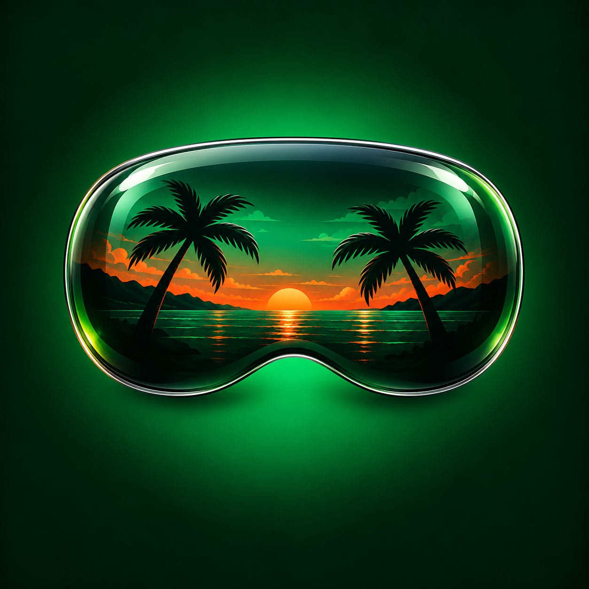

**[Windows / Linux: download the IPA and follow the full installation guide](docs/SIDELOADING.md)**

  

<h1 align="center">V</h1>

<strong>Our take on GTA V for iPhone, iPad, and Apple Vision Pro.</strong>

V brings the GTA V WebAssembly port into a native Apple app. Play on an iPhone or iPad, put Los Santos in a window on Vision Pro, or step into the experimental third-person immersive view with the character still in front of you.

This is our Apple-platform fork of [Muguet](https://github.com/c22dev/muguet). Muguet supplies the native WASM runtime foundation; V adds the Vision Pro app, window-to-immersive presentation, head-tracked per-eye rendering, graphics controls, save handling, and ongoing mobile-control improvements.

**V is a work in progress.** Windowed play is the visual reference. Immersive mode runs on a physical headset, but its grain, detail loss, edge artifacts, flicker, and performance still need work. A full-game completion pass is not certified.

[Windows / Linux IPA guide](docs/SIDELOADING.md) · [Mac source build](docs/INSTALL-VISION-PRO.md) · [Game files](docs/GAME-FILES.md) · [iPhone and iPad](#iphone-and-ipad) · [How it works](#how-it-works) · [Contributing](#contributing)

## What you can expect

| Platform | Experience | Current limits |
| --- | --- | --- |
| **Apple Vision Pro** | Native game window, gamepad input, and experimental third-person immersion with head tracking and separate eye views. | Immersive image quality and sustained performance are unfinished. First-person aiming, Sense motion controls, and hand tracking are not the supported setup path. |
| **iPhone / iPad** | Native app, on-device ZIP import, gamepad/keyboard input, and on-screen controls. | The latest automatic touch-control handoff is in development source, after the frozen V28 package; physical gameplay validation continues. |
| **Apple silicon Mac** | Inherited desktop runtime and the tools used to prepare mobile builds. | The main focus of this fork is iOS, iPadOS, and visionOS. |

The name on your device is **V**. The GitHub repository is currently **SantosVision**, and internal targets, bundle identifiers, and save paths still use SantosVision or Muguet. Those names preserve build and data compatibility; they are not separate apps you need to install.

## Install and play on Vision Pro

**Windows or Linux:** follow the [IPA installation walkthrough](docs/SIDELOADING.md)
for Apparition, pairing, Apple signing, the V30.1 download, game-file preparation
and transfer, and refreshes. No Mac is needed to install the published preview.

**Mac source build:** [From zero to V on Vision Pro](docs/INSTALL-VISION-PRO.md)
covers a fresh Mac checkout and the build steps below.

There are two things to install: **the app**, containing the compiled game code, and **your matching game data**. Installing the app alone does not make Play ready.

1. **Prepare compatible game files.** V needs the GTA V web-port package: `data/` plus `b/<build>/game.wasm` and its matching shaders. A retail PC installation, console disc image, or this repository's source ZIP cannot be imported directly.
2. **Build and sign V on your Mac.** The guide compiles the WASM ahead of time for Vision Pro and signs the native app with your own Apple development team.
3. **Install the app and copy the prepared data.** Pair your headset with Xcode, install V, then copy the imported game folder into its app container.
4. **Open V and choose Play.** Start in the ordinary game window with a compatible controller.
5. **Try immersion.** Once the game world is loaded and GTA's pause menu is closed, use the window's upper-right expand button, **Enter immersive view**.

**The current Vision Pro launcher does not have an on-device ZIP import button.**
For the IPA preview, prepare the matching data on Windows or Linux and copy it
through Files as described in the [sideloading guide](docs/SIDELOADING.md).
The source-build guide uses Mac-side preparation and transfer. The iPhone/iPad
ZIP picker is a different interface.

The main branch contains the V port; update an older Muguet-only checkout before following the build instructions.

An experimental [V30.1 IPA preview](docs/SIDELOADING.md) is available for re-signing with your own account. It exposes the app folder in Files for copying prepared game data from Windows or Linux. Fresh-account installation and gameplay through this route are not yet verified; the Mac source-build route above remains available.

### Source and installed-build status

The main branch contains our current V development work, not just the inherited Muguet launcher. **V30**, built from [`7bd22fb`](https://github.com/zschwendi/SantosVision/commit/7bd22fbacd4f656d7ff1039c73ae293a9102ac9d), was installed on an M2 Apple Vision Pro on October 28, 2026. V29 was rejected for washed-out rendering in both the cold game window and immersive. V30 [restores retained texture inputs in the shared renderer](docs/V30-TEXTURE-INPUT-REGRESSION.md), with new native pixel regressions, while retaining the immersive sharpness changes. In-headset visual acceptance of this correction is still pending.

The [fidelity checkpoint](docs/THIRD-PERSON-FIDELITY-20261025.md) and [V28 package record](docs/V28-FRONT-GLASS-PACKAGE-20261026.md) preserve the earlier investigation and frozen package history. The original 27.3 source is preserved by the `los-santos-third-person-quality-preview27-3-20261025` tag.

## Bring your game data

V includes no GTA V game assets. You must supply a compatible package you have the right to use. Owning the PC game does not automatically create the required WASM package, and V does not include a retail-to-WASM converter.

A supported package has **one build**, with code, shaders, and data that belong together:

~~~text
game.zip
├── data/
│   ├── manifest.json
│   └── …game assets…
└── b/
    └── <build-id>/
        ├── game.wasm
        └── shaders/
            ├── index.json
            └── …WGSL shaders…
~~~

Run the package check before compiling or importing:

~~~sh
python3 scripts/validate-game.py /absolute/path/to/game.zip
~~~

[Game-file preparation](docs/GAME-FILES.md) explains supported layouts, validation, and assembly of the previously tested snapshot. Changing the ZIP's name or wrapping a PC install in this layout does not convert it. Use the same package for the build and the later import.

## iPhone and iPad

The iOS/iPadOS launcher has an actual file picker:

1. Install a device-signed V build with the matching game code embedded.
2. Put the compatible ZIP somewhere the device's Files picker can access. Download it locally before starting a large import.
3. Open V and select **Import game data .zip**.
4. Keep the app in the foreground until **Importing…** finishes, then choose **Play**.

Source builds use the existing iOS helper after installing Rust 1.98.1, the `aarch64-apple-ios` target, and XcodeGen:

~~~sh
rustup toolchain install 1.98.1
rustup target add aarch64-apple-ios --toolchain 1.98.1
RUSTUP_TOOLCHAIN=1.98.1 \
  TEAM=YOUR_TEAM_ID BUNDLE_ID=com.yourname.v \
  ./make-ios.sh /absolute/path/to/game.zip --install YOUR_DEVICE_ID
~~~

Use your own signing identity and select the exact iPhone or iPad from `xcrun devicectl list devices`. The helper's internal Xcode target remains **Muguet**; the installed app title is **V**. The project's iOS deployment target is 15.0, which is not a promise of acceptable performance on every device running that version. The normal build requests increased-memory and extended-address-space entitlements; signing eligibility and available memory matter.

The helper also supports `--ipa` and a reduced-memory `FREE=1` configuration. These are packaging options, not a guarantee that every signing service or free account will run the game. See `make-ios.sh` before choosing them.

### Controls

A normal compatible gamepad is the starting point on Vision Pro. Use GTA's own button prompts for movement, combat, driving, and menus. Advanced tracked aiming and hand interactions are unfinished.

On iPhone and iPad, the latest source shows touch controls during gameplay when neither an extended game controller nor a hardware keyboard is connected. They cover movement, camera, combat, vehicles, interaction, weapons, and menu navigation. Connecting a physical input device hides the overlay and releases touch-held inputs. This improvement is for the next build after the frozen V28 package.

## Graphics and immersion

V keeps the game's rendering effects and builds immersion from separately retained per-eye color, depth, and camera data. The current focus is making that immersive image match the finished windowed game more closely.

Vision Pro Settings offers **Existing GTA**, **Performance**, and **Clarity** presets. A fresh configuration starts at **960×540**, a **60 FPS cap**, and **Existing GTA**. Existing saved choices remain in use. A frame cap is a limit, not measured performance.

Change launch graphics settings before Play; quit the game and reopen V to apply another configuration. Raising resolution costs memory and render time, and cannot by itself fix every reprojection artifact.

Known work remains on:

- Fine detail and grain: extra image coverage for head movement spreads the available source samples over a larger view.
- Depth edges, uncovered areas, and temporal flicker.
- Latency and sustained performance on the headset.
- HUD presentation and broader mission/device compatibility.

Local shader comparisons demonstrate specific fixes; they do not certify a finished headset experience or 60 FPS. Developers can find the current evidence in the [third-person fidelity checkpoint](docs/THIRD-PERSON-FIDELITY-20261025.md).

## Saves and updates

Save through GTA's own menus. The Vision Pro app keeps game data in `Documents/game` and local saves separately in `Documents/saves`.

Install updates over the existing app using the same signing identity and bundle ID. Export or back up your app data before changing identity or replacing an installation; deleting the app also deletes its local container.

Vision Pro includes save-history and iCloud integration, but cloud sync requires a correctly provisioned container. The public source-build guide uses **local saves** so you do not need the maintainer's iCloud setup. [Save-sync developer notes](visionos/SAVE-SYNC.md) explain that separate configuration. Cross-device save compatibility is not assumed.

## How it works

The web port supplies `game.wasm` and translated WGSL shaders. V hosts the game using [Wasmtime](https://wasmtime.dev/) and [wgpu](https://wgpu.rs/), with Apple's Metal underneath.

On iPhone, iPad, and Vision Pro, the game code is compiled to ARM64 **before installation** and embedded in the signed app. The device does not need an on-device JIT or jailbreak. Imported data supplies the world, textures, audio, and matching shaders; it does not replace the embedded executable.

On Vision Pro, a SwiftUI app manages the launcher and game window. ARKit and CompositorServices provide the tracking and presentation used by the experimental immersive renderer. Windowed and immersive views share the same game session.

Upstream Muguet also includes experimental UDP multiplayer. It is not GTA Online, and multiplayer interoperability is outside this fork's current verified setup path.

## Contributing

Start with the [Vision Pro setup guide](docs/INSTALL-VISION-PRO.md), [native integration notes](visionos/README.md), and the latest [fidelity checkpoint](docs/THIRD-PERSON-FIDELITY-20261025.md). Preserve player data and keep source/build checks separate from physical-device results.

| Location | Purpose |
| --- | --- |
| `src/` | Rust runtime, game imports, Metal/wgpu integration, input and camera hooks |
| `visionos/` | Native Vision Pro app, game window, immersive renderer and focused checks |
| `ios/` | iPhone/iPad launcher, signing configuration and app assets |
| `launcher/` | Inherited desktop launcher |
| `scripts/` | Package validation, assembly, native builds and development checks |
| `docs/` | Setup, architecture and dated investigation records |

Please do not commit game packages, extracted assets, saves, private device captures, or signing material. Development records are dated evidence, not promises that every experiment ships in a release.

## Credits and license

V is our Apple-platform take by **Zach Schwendiman / Zephyr Studios**, built on **Constantin Clerc (c22dev)'s [Muguet](https://github.com/c22dev/muguet)** and the GTA V WebAssembly port it hosts. Wasmtime, wgpu, and their contributors make the native runtime possible. Upstream attribution is retained; this repository is [GPL-3.0-or-later](LICENSE).

GTA V and its game assets belong to their respective rights holders. V is an unofficial community project, unaffiliated with Rockstar Games, Take-Two Interactive, or Apple.

## Issues

[Check existing issues](https://github.com/zschwendi/SantosVision/issues) before opening a bug report or feature request. Include your device and OS, V build or source commit, windowed versus immersive mode, graphics settings, reproduction steps, and relevant logs. Explain what you expected and what happened; avoid uploading game files or personal data. Please keep Issues focused on bugs and feature requests.
